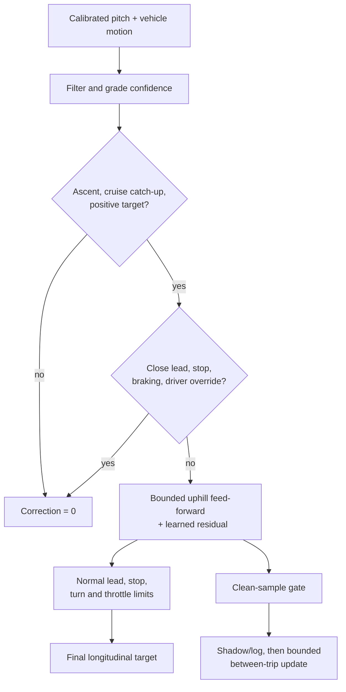

# Subaru Ascent grade-aware longitudinal adaptation

## Intent

Help the 2021 Subaru Ascent hold its requested speed on steep uphill sections, while releasing the added accelerator promptly over crests and downhill sections. Improve the calibration gradually from clean driving evidence between trips. This addresses the reported mountain-road case where grades reached about 15% and the Ascent struggled to reach the cruise setpoint.

## Goals

- Estimate uphill/downhill grade from available vehicle orientation data, with filtering and validity checks.
- Add bounded, smooth positive acceleration compensation when cruise is below its set speed and no close lead or stop condition is constraining the car.
- Preserve all existing planner, lead-follow, stop, braking, turn, and force-deceleration authority. Grade compensation must never weaken a negative acceleration request.
- Learn a small, bounded speed-by-grade residual calibration from clean samples and persist it across drives, without rewriting source code or publishing changes automatically.
- Make the correction and learning observable in logs, disableable, and resettable if the vehicle identity or calibration is wrong.

## Non-goals

- No change to the base Subaru throttle/RPM feed-forward tables in this feature.
- No change to following-distance targets, stop-and-go behavior, AEB, EyeSight, or Panda firmware.
- No learning from samples with a lead vehicle constraining acceleration, braking, driver pedal input, stop/force-decel states, invalid slope data, or engagement transitions.
- No automated source-code edits, Git commits, pushes, or Comma deployments.

## Anti-goals

- Do not chase a cruise setpoint through a close lead or override radar/model/stop constraints.
- Do not retain a correction that causes throttle pulsing, downhill over-speed, or oscillation at a crest.
- Do not infer road grade from speed error alone; speed error is an outcome signal and can be caused by a lead, turn, power limit, or planner constraint.

## Current behavior and constraints

- `selfdrive/controls/lib/longitudinal_planner.py` already receives `carControl.orientationNED`, radar leads, cruise state, and the selected longitudinal plan source. It currently derives a coast acceleration from pitch and contains multiple follow/stop caps after the initial plan target is selected.
- `selfdrive/controls/controlsd.py` fills `carControl.orientationNED` from the calibrated pose. Orientation can be affected by vehicle-body pitch under acceleration, braking, suspension motion, and sensor noise; it is not a perfect direct road-grade sensor.
- The correct integration point is the planner, before the normal follow/stop arbitration, so existing downstream caps remain authoritative. The Ascent-only vehicle check must match the existing `SUBARU_ASCENT` fingerprint.
- `opendbc` and openpilot have other pitch-aware longitudinal paths, but this design uses them as precedent only; it does not assume their calibration is valid for this Ascent.

## Approaches considered

1. **Speed-error-only boost.** Simple, but cannot distinguish a hill from a lead or other planner limit and risks throttle pulsing. Rejected.
2. **Planner-side grade feed-forward with lead/stop gating, then bounded learning.** Uses the grade estimate to anticipate hill load, while the planner's known lead and stop constraints retain authority. This is the selected approach because it addresses the mountain case without training on traffic-limited acceleration.
3. **Offline-only analysis and manual table updates.** Easier to audit but does not adapt between trips and would require repeated manual calibration. Retain as the fallback if live grade confidence proves inadequate.

## Proposed behavior

### 1. Runtime grade compensation

- Restrict behavior to the 2021 Ascent fingerprint and openpilot longitudinal control.
- Filter the pitch signal and compensate or reject samples whose apparent pitch is likely caused by longitudinal body motion. Use a confidence/validity gate; on missing or implausible data, apply zero grade correction.
- Convert valid uphill grade to a feed-forward acceleration estimate. Ramp it in and out to avoid abrupt torque changes. Release quickly when uphill grade falls, a crest/downhill is detected, the requested speed is reached, or the feature becomes ineligible.
- Add only a positive, conservatively bounded correction to the cruise-driving target, and only when `vCruise` exceeds ego speed by a meaningful margin and the candidate target is positive. A negative planner target is never raised by this feature.
- Apply correction before existing lead-follow and stop arbitration. Existing radar/model braking, stop logic, turn limits, throttle limits, and force-decel caps must still be able to reduce or remove the correction.
- Treat a lead as close when the selected lead is inside the desired follow gap plus a small guard margin, or its time-to-collision is below a conservative threshold while closing. In that state, grade compensation is zero. A stopped lead, planner-selected lead constraint, stop/force-decel condition, brake input, gas override, or inactive longitudinal control also disables it.
- If the MPC is following a lead that is outside the close gate, retain the existing follow policy as final authority; do not add an independent lead-agnostic correction after follow arbitration.

### 2. Between-trip learning

- Keep the physical grade feed-forward and learned residual as separate terms. Learning may correct only a small residual where the same speed/grade cell repeatedly shows a clean, persistent speed deficit despite available positive acceleration request.
- Accept samples only during stable Ascent longitudinal operation with valid grade, cruise set speed above ego speed, no lead limiting, no stops, no braking, no driver pedal input, no turn cap, and no engagement transition. Reject short-lived transients and saturated/invalid sensor samples.
- Start in **shadow mode**: calculate and log proposed learned values without applying them. After shadow data has been inspected, enable application through an explicit parameter/feature gate.
- Persist a bounded calibration map keyed by vehicle identity and coarse speed/grade bands, with update-rate limits, decay toward zero when evidence is absent, and a one-step rollback/reset mechanism. A mismatched vehicle identity or malformed data disables learning and starts from the safe zero residual.
- Keep learned values in runtime parameters/data, not source files. No automatic code patching, commit, push, or deployment.
- Log sample eligibility/rejection reason, grade estimate/confidence, requested and measured acceleration, speed error, lead state/gap/TTC, feed-forward term, learned term, final correction, and calibration version.

## Processing flow

## Validation required before installation

- Unit tests for flat, uphill, crest, downhill, noisy/missing pitch, body-motion transients, setpoint reached, close/closing lead, distant lead, stop, braking, driver override, disabled longitudinal control, and vehicle mismatch.
- Planner-level tests proving the correction is added only before arbitration and that downstream lead/stop/negative-acceleration caps always win.
- Persistence tests for malformed calibration, identity mismatch, bounds, rate limiting, no-evidence decay, disable, and rollback.
- Replay or synthetic maneuvers covering a steep hill, crest transition, downhill, and following a slower vehicle; check for acceleration pulses and unwanted downhill acceleration.
- First vehicle trial should use shadow logging or a deliberately low correction ceiling in a closed course, then review the data before increasing the limit. The new behavior remains unvalidated on-road until that trial.

## Decisions and builder-owned details

- User selected planner-side grade compensation plus bounded learning between trips, with compensation blocked while closely following another vehicle.
- The builder may select exact filter constants, confidence tests, close-lead thresholds, initial correction ceiling, learning rate, persistence format, and feature parameter names. These must be conservative, documented, and covered by tests; they must not weaken the gates or existing planner constraints above.
- If available signals cannot distinguish road grade from body pitch reliably, keep runtime compensation disabled and deliver shadow logging plus an offline calibration report rather than guessing.

## Rollout

1. Implement and run targeted unit/planner/persistence checks locally.
2. Enable shadow logging first and collect a closed-course dataset.
3. Review measured correction and lead gating; only then enable the bounded live term for a controlled test.
4. Review the resulting route logs before any further tuning or deployment.
